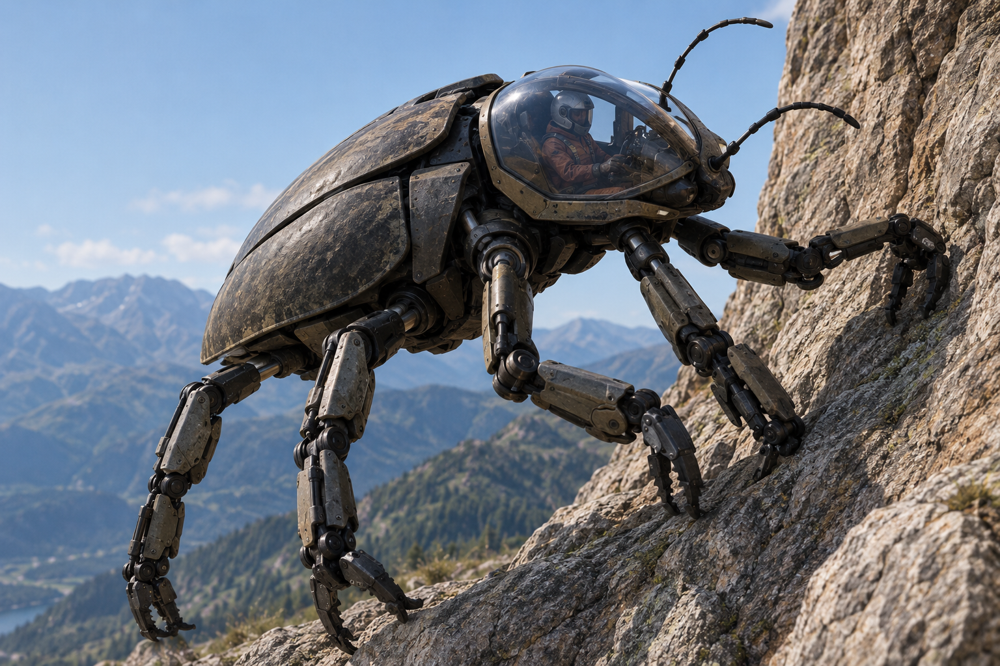

# ТЗ: Шестилапый скалолаз «Базальт»

Автор: Гурьянов Максим Сергеевич (БСБО-16-23, №5)
Стихия: земля
Проект: Шестилапый скалолаз «Базальт»
Репозиторий: https://github.com/GurianovM/basalt_climber.git
Дата заморозки: - (не заморожено) 
Версия: 0.1

| Роль                  | Участник            |
| --------------------- | ------------------- |
| A - автор ТЗ и тестов | Гурьянов М. С. (№5) |
| B - ревьюер           | Клинный А. И. (№9)  |
| C - ревьюер           | Ивчук М. П. (№7)    |
| D -  разработчик      | Родин Е. Д. (№17)   |

---

## 1. Назначение

«Базальт» - механическое транспортное средство, передвигающееся на шести мощных конечностях с усиленными захватами для сцепления с поверхностью. Предназначен для перевозки одного пилота по пересеченной местности, включая отвесные скалы и каменные уступы. Способен удерживаться на почти вертикальных поверхностях благодаря особому механизму фиксации лап и менять положение тела для преодоления неровностей.


---

## 2. Стихия и конструкционный элемент

**Стихия:** земля.

**Конструкционный элемент:** не менее одного элемента, обеспечивающего сцепление с поверхностью и удержание на отвесных скалах.

**Как реализован элемент:**

> Шесть механических конечностей (атрибут `leg_count = 6`) с захватами и механизмом фиксации на поверхности. Каждая лапа оснащена датчиками контакта и приводом, позволяющим регулировать силу сцепления. При отказе механизма фиксации лап транспорт теряет способность безопасно передвигаться по отвесным поверхностям.
> 
> В модели: число исправных лап - `working_legs` (0…6). Каждая исправная лапа удерживает 60 кг массы, поэтому «грузоподъемность сцепления» `grip_capacity_kg = working_legs × 60`. Подъем на скалу возможен, только если исправны не менее трех лап (`working_legs ≥ 3`) и масса аппарата не превышает грузоподъемности сцепления (`mass_kg ≤ grip_capacity_kg`). Если на скале лапы повреждены настолько, что условие нарушилось, аппарат срывается и оказывается на земле.

**Ограничения стихии:**

- Основной режим - передвижение по земле, камням и скальным поверхностям.
- Может подниматься по отвесным скалам и удерживаться на почти вертикальных поверхностях.
- Не предназначен для полета и длительного передвижения по воде (в воду не входит ни в каком виде).
- Передвижение по рыхлому грунту, сыпучему песку и неустойчивым поверхностям ограничено: скорость вдвое ниже, расход энергии вдвое выше.
- При повреждении нескольких конечностей способность передвигаться и удерживаться на скалах снижается: при менее чем трех исправных лапах аппарат не может двигаться вообще.

---

## 3. Публичный интерфейс

Разработчик реализует ровно то, что описано в этом разделе. Все остальное - внутренняя реализация.

### 3.0. Общие правила (действуют для всех методов)

1. **Число** - значение типа `int` или `float`, но **не** `bool`. Нечисловое значение там, где ожидается число, - `TypeError`.
2. Строковый параметр, переданный не как `str`, - `TypeError`.
3. Порядок проверок: сначала типы (`TypeError`), затем значения (`ValueError`), затем доменные правила (раздел 6.3).
4. **Атомарность:** метод, выбросивший исключение, не меняет состояние объекта.
5. Числовые атрибуты-величины (`mass_kg`, `max_speed_kmh`, `energy`, `position_km`, `grip_capacity_kg`) хранятся как `float` (переданный `int` приводится к `float`). Атрибуты-счетчики (`leg_count`, `working_legs`) - `int`.
6. Дробные результаты тесты сравнивают с точностью до 6 знаков после запятой.

### 3.1. Класс

```python
class BasaltClimber:
```

Имя класса: `BasaltClimber` Модуль: `basalt_climber.py` (в корне репозитория). В этом же модуле объявлены все исключения раздела 6.

### 3.2. Конструктор

```python
def __init__(
    self,
    name: str,
    mass_kg: float,
    max_speed_kmh: float,
    energy: float = 100.0,
) -> None:
```

|Параметр|Тип|Единица|Допустимый диапазон|По умолчанию|
|---|---|---|---|---|
|name|str|-|строка, содержащая хотя бы один непробельный символ|-|
|mass_kg|число|кг|> 0|-|
|max_speed_kmh|число|км/ч|> 0|-|
|energy|число|усл. ед.|0 … 100 включительно|100.0|

Число лап `leg_count` не передается в конструктор: оно всегда равно 6.

**Исключения конструктора:**

- `TypeError` - `name` не `str`; любой числовой параметр не число (в том числе `bool`, `None`, `str`).
- `ValueError` - `name` пустой или состоит только из пробельных символов.
- `ValueError` - `mass_kg` или `max_speed_kmh` ≤ 0.
- `ValueError` - `energy` < 0 или `energy` > 100.

**Начальное состояние:** `position_km == 0.0`, `is_climbing == False` (аппарат стоит на земле), `working_legs == 6`.

### 3.3. Атрибуты

Все атрибуты **только для чтения**: попытка присвоить значение - `AttributeError`.

|Атрибут|Тип|Единица|Доступ|Описание|
|---|---|---|---|---|
|name|str|-|чтение|Имя аппарата|
|mass_kg|float|кг|чтение|Полная масса (аппарат + пилот)|
|max_speed_kmh|float|км/ч|чтение|Максимальная скорость по ровной поверхности|
|energy|float|усл. ед.|чтение|Текущий запас энергии, 0 … 100|
|position_km|float|км|чтение|Суммарное пройденное расстояние|
|is_climbing|bool|-|чтение|Находится ли аппарат на отвесной скале|
|leg_count|int|шт.|чтение|Число лап, всегда 6|
|working_legs|int|шт.|чтение|Число исправных лап, 0 … 6|
|grip_capacity_kg|float|кг|чтение|Грузоподъемность сцепления: `working_legs × 60`|
|can_walk|bool|-|чтение|`True` ⇔ `working_legs ≥ 3` и `energy > 0`|
|can_climb|bool|-|чтение|`True` ⇔ `working_legs ≥ 3` и `mass_kg ≤ grip_capacity_kg` и `energy > 0`|

### 3.4. Методы

#### 3.4.1. move

```python
def move(self, distance_km: float, terrain: str) -> float:
```

**Назначение:** перемещает аппарат на заданное расстояние по заданной поверхности.

**Параметры:**

- `distance_km` - число, км, > 0 (для скалы - длина пути вдоль скалы).
- `terrain` - поверхность: `"rock"` (камень и твердая земля), `"sand"` (песок и рыхлый грунт), `"cliff"` (отвесная скала), `"water"` (вода).

**Возвращает:** время перемещения в часах (`float`).

**Изменяет:** `position_km` (+ `distance_km`), `energy` (− расход), `is_climbing`.

**Правила:**

|terrain|Скорость|Расход энергии|is_climbing после|Дополнительные условия|
|---|---|---|---|---|
|"rock"|max_speed_kmh|distance_km × 1|False|`working_legs ≥ 3`|
|"sand"|max_speed_kmh × 0.5|distance_km × 2|False|`working_legs ≥ 3`|
|"cliff"|max_speed_kmh × 0.25|distance_km × 4|True|`working_legs ≥ 3`; `mass_kg ≤ grip_capacity_kg`|
|"water"|-|-|-|всегда `BasaltCannotSwim`|

- Расход, в точности равный запасу, допустим: после перемещения `energy == 0`.
- Подъем и спуск отдельно не моделируются: `move(..., "cliff")` с земли означает начало подъема, `move(..., "rock")` или `move(..., "sand")` со скалы - спуск.
- Высота не моделируется: пройденный путь по скале просто прибавляется к `position_km`.

**Исключения** (в порядке проверки):

1. `TypeError` - `distance_km` не число или `terrain` не `str`.
2. `ValueError` - `distance_km` ≤ 0.
3. `ValueError` - `terrain` не из списка.
4. `BasaltCannotSwim` - `terrain == "water"`.
5. `BasaltLegsDamaged` - `terrain` in (`"rock"`, `"sand"`, `"cliff"`) и `working_legs < 3`.
6. `BasaltGripFailure` - `terrain == "cliff"` и `mass_kg > grip_capacity_kg`.
7. `BasaltNoStrength` - расход больше текущего `energy`.

#### 3.4.2. can_overcome

```python
def can_overcome(self, obstacle: str) -> bool:
```

**Назначение:** проверяет, может ли аппарат в текущем состоянии преодолеть препятствие. Состояние **не меняется**, энергия **не тратится**.

**Параметры:** `obstacle` - `"wall"`, `"river"`, `"boulder"`.

**Возвращает:** `True` / `False`.

**Правила:**

|obstacle|Результат True, если|
|---|---|
|"wall" (отвесная стена)|`is_climbing` или `can_climb` (если уже на скале, стену преодолевать можно даже без энергии)|
|"river" (река)|никогда (вплавь нельзя, мостов в модели нет)|
|"boulder" (валун)|`working_legs ≥ 4` и `energy > 0` (нужно перешагнуть, сместив корпус)|

**Исключения:**

- `TypeError` - `obstacle` не `str`.
- `ValueError` - `obstacle` не из списка.

#### 3.4.3. calculate_energy

```python
def calculate_energy(self, distance_km: float, terrain: str) -> float:
```

**Назначение:** рассчитывает расход энергии на перемещение без изменения состояния.

**Параметры:** те же, что у `move`.

**Возвращает:** расход энергии (`float`) по формуле из 3.4.1.

**Исключения:** `TypeError`, `ValueError`, `BasaltCannotSwim` - как у `move`. **Не** выбрасывает `BasaltLegsDamaged`, `BasaltGripFailure`, `BasaltNoStrength`: метод считает стоимость, а не проверяет возможность.

#### 3.4.4. refuel

```python
def refuel(self, amount: float) -> None:
```

**Назначение:** пополнить запас энергии.

**Параметры:** `amount` - число, > 0.

**Возвращает:** `None`.

**Изменяет:** `energy = min(100, energy + amount)`.

**Исключения:**

- `TypeError` - `amount` не число.
- `ValueError` - `amount` ≤ 0.

#### 3.4.5. damage_leg

```python
def damage_leg(self) -> None:
```

**Назначение:** доменное событие «одна лапа выведена из строя» (обвал, удар о камень, отказ привода).

**Изменяет:** `working_legs = max(0, working_legs − 1)`. Если после этого `is_climbing == True`, а условие сцепления нарушено (`working_legs < 3` или `mass_kg > grip_capacity_kg`), аппарат срывается: `is_climbing = False`. `position_km` и `energy` не меняются.

**Исключения:** нет. Вызов при `working_legs == 0` ничего не меняет.

#### 3.4.6. repair_legs

```python
def repair_legs(self) -> None:
```

**Назначение:** отремонтировать все лапы.

**Изменяет:** `working_legs = 6`. Остальное состояние не меняется (в том числе `is_climbing` остается прежним).

**Исключения:** нет. Вызов при полностью исправных лапах ничего не меняет.

#### 3.4.7. get_status

```python
def get_status(self) -> dict:
```

**Назначение:** возвращает снимок состояния.

**Возвращает:** **новый** словарь ровно с ключами:

|Ключ|Тип|
|---|---|
|"name"|str|
|"energy"|float|
|"position_km"|float|
|"is_climbing"|bool|
|"working_legs"|int|
|"can_walk"|bool|
|"can_climb"|bool|

Изменение возвращенного словаря не влияет на объект.

### 3.5. Сводка констант домена

|Величина|Значение|
|---|---|
|Число лап|6|
|Удерживающая способность одной лапы|60 кг|
|Минимум исправных лап для движения|3|
|Минимум исправных лап для преодоления валуна|4|
|Скорость по камню|max_speed_kmh|
|Скорость по песку|max_speed_kmh × 0.5|
|Скорость по скале|max_speed_kmh × 0.25|
|Расход энергии по камню|1 ед. на 1 км|
|Расход энергии по песку|2 ед. на 1 км|
|Расход энергии на скале|4 ед. на 1 км|
|Максимальный запас энергии|100 ед.|

---

## 4. Сценарии

Если не сказано иное, используется эталонный аппарат: `BasaltClimber("Базальт", mass_kg=300, max_speed_kmh=12)` - 6 исправных лап, грузоподъемность сцепления 360 кг, энергия 100.

### 4.1. Модульные тесты (AAA)

**Сценарий 1. Обычная ходьба** Дано: эталонный аппарат, `energy = 100`. Когда: `move(6, "rock")`. Тогда: возвращается `0.5`; `position_km == 6`; `energy == 94`; `is_climbing == False`.

**Сценарий 2. Подъем с нехваткой энергии** Дано: `energy = 10`. Когда: `move(5, "cliff")`. Тогда: `BasaltNoStrength` с `required == 20`, `available == 10`; состояние не изменилось.

**Сценарий 3. Слишком тяжелый для сцепления** Дано: `mass_kg = 400` (грузоподъемность сцепления 360). Когда: `move(0.1, "cliff")`. Тогда: `BasaltGripFailure`; `can_climb == False`.

**Сценарий 4. Подзарядка** Дано: `energy = 20`. Когда: `refuel(50)`. Тогда: `energy == 70`.

### 4.2. Функциональные (сценарные) тесты (GWT)

Сценарии управляются тестовыми обертками, они живут в `tests/` и не входят в реализацию:

- **Pilot** - пилот, отдает команды на доменном языке: `идти_по_камням(км)`, `идти_по_песку(км)`, `лезть_на_скалу(км)`, `спуститься(км)`, `переплыть(км)`, `может_преодолеть(препятствие)`, `подзарядиться(количество)`.
- **Rockfall** - обвал, событие внешнего мира: `обрушить(аппарат)` выводит из строя одну лапу.
- **Workshop** - мастерская: `починить_лапы(аппарат)` восстанавливает все лапы.

#### Сценарий 5. Доставка груза в горный приют

```gherkin
Given эталонный «Базальт» с энергией 100 стоит на земле
When пилот идет по камням 12 км
Then время 1.0 ч
And энергия 88, пройдено 12 км, аппарат не на скале
When пилот проверяет, может ли он преодолеть валун и стену
Then может и то и другое
When пилот лезет на скалу 1.5 км
Then время 0.5 ч
And энергия 82, пройдено 13.5 км, аппарат на скале
When пилот проверяет, может ли он преодолеть реку
Then не может
When пилот пытается переплыть 1 км
Then BasaltCannotSwim
And состояние не изменилось: энергия 82, пройдено 13.5 км, аппарат на скале
When пилот спускается 1.5 км
Then время 0.125 ч
And энергия 80.5, пройдено 15 км, аппарат не на скале
When пилот идет по песку 3 км
Then время 0.5 ч
And энергия 74.5, пройдено 18 км
When пилот пытается лезть на скалу 20 км
Then BasaltNoStrength: нужно 80, есть 74.5
And пройдено по-прежнему 18 км, энергия 74.5, аппарат не на скале
When пилот подзаряжается на 30 и лезет на скалу 10 км
Then энергия 60 (после подзарядки было 100, не больше максимума)
And время 3.333333 ч, пройдено 28 км, аппарат на скале
```

#### Сценарий 6. Обвал на карнизе

```gherkin
Given эталонный «Базальт» с энергией 100
When пилот лезет на скалу 2 км
Then время 0.666667 ч
And энергия 92, пройдено 2 км, аппарат на скале
When обвал выводит из строя одну лапу
Then исправных лап 5, грузоподъемность сцепления 300 кг
And масса равна грузоподъемности, поэтому аппарат остается на скале и can_climb == True
When обвал выводит из строя еще одну лапу
Then исправных лап 4, грузоподъемность сцепления 240 кг
And аппарат сорвался: он не на скале, can_climb == False
And энергия 92, пройдено 2 км
When пилот пытается лезть на скалу 1 км
Then BasaltGripFailure
And энергия 92, пройдено 2 км
When пилот проверяет, может ли он преодолеть стену и валун
Then стену не может, валун может (4 лапы)
When пилот идет по камням 3 км
Then время 0.25 ч, энергия 89, пройдено 5 км
When обвал выводит из строя еще две лапы
Then исправных лап 2, can_walk == False
When пилот пытается идти по камням 1 км
Then BasaltLegsDamaged
And энергия 89, пройдено 5 км
When пилот проверяет, может ли он преодолеть валун
Then не может
When мастерская чинит лапы
Then исправных лап 6, can_climb == True, аппарат по-прежнему не на скале
When пилот лезет на скалу 2 км
Then время 0.666667 ч, энергия 81, пройдено 7 км, аппарат на скале
```

#### Сценарий 7. Тяжеловес у реки

```gherkin
Given «Тяжеловес»: масса 400 кг, скорость 12 км/ч, энергия 100
Then грузоподъемность сцепления 360 кг, can_climb == False, can_walk == True
When пилот пытается лезть на скалу 1 км
Then BasaltGripFailure, пройдено 0 км, энергия 100
When пилот проверяет, может ли он преодолеть стену и реку
Then не может ни то ни другое
When пилот пытается переплыть 1 км
Then BasaltCannotSwim, состояние не изменилось
When пилот идет по камням 20 км вдоль реки
Then время 1.666667 ч, энергия 80, пройдено 20 км
When пилот идет по песку 40 км
Then время 6.666667 ч, энергия 0, пройдено 60 км
And can_walk == False
When пилот пытается пройти по камням еще 1 км
Then BasaltNoStrength: нужно 1, есть 0
When пилот подзаряжается на 1000
Then энергия 100 (не больше максимума)
And итог: пройдено 60 км, аппарат не на скале, can_climb == False
```

#### Сценарий 8. Последний рывок на скале

```gherkin
Given эталонный «Базальт» с энергией 100
When пилот лезет на скалу 25 км
Then время 8.333333 ч, энергия 0, пройдено 25 км, аппарат на скале
And can_climb == False, но стену преодолеть может (он уже на скале)
And реку преодолеть не может
When пилот пытается лезть еще 0.25 км
Then BasaltNoStrength: нужно 1, есть 0
And пройдено по-прежнему 25 км
When пилот подзаряжается на 4
Then энергия 4, can_climb == True
When пилот лезет на скалу 1 км
Then время 0.333333 ч, энергия 0, пройдено 26 км, аппарат на скале
```

#### Сценарий 9. Впритык по сцеплению

```gherkin
Given «Ровня»: масса 240 кг, скорость 8 км/ч, энергия 40
When обвал выводит из строя две лапы
Then исправных лап 4, грузоподъемность сцепления 240 кг
And масса равна грузоподъемности, can_climb == True
When пилот лезет на скалу 5 км
Then время 2.5 ч, энергия 20, пройдено 5 км, аппарат на скале
When обвал выводит из строя еще одну лапу
Then исправных лап 3, грузоподъемность сцепления 180 кг
And аппарат сорвался и не на скале
When пилот пытается лезть на скалу 1 км
Then BasaltGripFailure
When пилот идет по камням 10 км
Then время 1.25 ч, энергия 10, пройдено 15 км
When пилот идет по песку 5 км
Then время 1.25 ч, энергия 0, пройдено 20 км
When мастерская чинит лапы
Then исправных лап 6, но can_climb == False, потому что энергия 0
When пилот пытается лезть на скалу 1 км
Then BasaltNoStrength: нужно 4, есть 0
```

### 4.3. Test Case Specification

Таблица тест-кейсов - в TEST_CASES.md. Каждый тест-метод содержит ID своего TC в имени и docstring.

---

## 5. Граничные случаи

|Случай|Ожидание|TC|
|---|---|---|
|Расход ровно равен запасу: `move(25, "cliff")` при `energy = 100`|`energy == 0`, `position_km == 25`, без исключения|TC-15|
|Масса ровно равна грузоподъемности сцепления (300 кг при 5 лапах)|подъем разрешен|TC-16|
|Ровно 3 исправные лапы|ходьба по камню и песку разрешена; при 2 лапах - `BasaltLegsDamaged`|TC-17|
|`refuel(1000)` при `energy = 50`|`energy == 100`, не больше|TC-23|
|`bool` вместо числа: `mass_kg=True`, `move(True, "rock")`, `refuel(True)`|`TypeError`, хотя `bool` - подкласс `int`|TC-05, TC-13, TC-24|
|Имя из одних пробелов `" "`|`ValueError`|TC-02|
|Несколько нарушений сразу: 2 исправные лапы и `energy = 0`|`BasaltLegsDamaged` (порядок проверок 6.3)|TC-18|
|`damage_leg()` при `working_legs == 0`|`working_legs` остается 0, без исключения|TC-26|
|`energy == 0` на скале|аппарат остается на скале, `can_climb == False`, «стена» преодолима|TC-33|

---

## 6. Исключения

### 6.1. Иерархия

```
Exception
└── CrazyVehicleError
    └── BasaltError
        ├── BasaltCannotSwim
        ├── BasaltNoStrength
        ├── BasaltGripFailure
        └── BasaltLegsDamaged
```

Ошибки параметров - стандартные исключения (`TypeError`, `ValueError`). Нарушения правил домена - доменные исключения. `RuntimeError` не используется.

`BasaltNoStrength` создается как `BasaltNoStrength(required: float, available: float)` (аргументы можно передавать и по имени) и имеет публичные атрибуты `required: float` (сколько энергии нужно) и `available: float` (сколько есть). Остальные доменные исключения создаются со строкой-сообщением.

### 6.2. Таблица

|Ситуация|Исключение|Сообщение|
|---|---|---|
|Параметр неверного типа|TypeError|"<param> must be a number" / "<param> must be a string"|
|Пустое имя|ValueError|"name must not be empty"|
|Неположительные масса / скорость|ValueError|"<param> must be positive"|
|Энергия вне 0…100 при создании|ValueError|"energy must be between 0 and 100"|
|Неположительная дистанция|ValueError|"distance_km must be positive"|
|Неизвестная поверхность / препятствие|ValueError|"unknown terrain: <x>" / "unknown obstacle: <x>"|
|Неположительная подзарядка|ValueError|"amount must be positive"|
|Попытка войти в воду|BasaltCannotSwim|"basalt cannot swim: water short-circuits the drives"|
|Не хватает энергии|BasaltNoStrength|"not enough energy: required X, have Y"|
|Масса больше грузоподъемности сцепления|BasaltGripFailure|"grip failure: mass X kg, grip capacity Y kg"|
|Меньше трех исправных лап|BasaltLegsDamaged|"not enough working legs: X of 6"|

Тесты проверяют тип исключения и атрибуты `required` / `available`. Текст сообщения тестами не проверяется.

### 6.3. Порядок проверок

`TypeError` - `ValueError` - `BasaltCannotSwim` - `BasaltLegsDamaged` - `BasaltGripFailure` - `BasaltNoStrength`. При нескольких нарушениях выбрасывается первое по этому порядку.

---

## 7. Что вне рамок

- Высота подъема, угол наклона скалы, погода, трение и тип породы не моделируются.
- Подъем и спуск не являются отдельными действиями (см. 3.4.1).
- Груз и изменение массы после создания не поддерживаются.
- Состояние отдельных лап (какая именно повреждена) не моделируется, учитывается только их число.
- Аппарат не взаимодействует с другими транспортами.
- Нет графики и визуализации в коде (картинка в ТЗ только иллюстрирует).
- Нет сохранения состояния между запусками, работы с файлами, сетью и API.

---

## 8. Трассируемость «требование - тест»

|Требование|Раздел ТЗ|Тест|
|---|---|---|
|Корректное создание и начальное состояние|3.2, 3.3|test_tc01_init_valid_defaults|
|Имя не пустое и не из пробелов|3.2|test_tc02_init_empty_name_raises|
|Масса и скорость > 0|3.2|test_tc03_init_non_positive_values_raise|
|Энергия при создании в 0…100|3.2|test_tc04_init_energy_range|
|Типы параметров конструктора|3.0, 3.2|test_tc05_init_wrong_types_raise|
|Атрибуты только для чтения|3.3|test_tc06_attributes_read_only|
|Ходьба по камню: скорость, расход, позиция|3.4.1|test_tc07_move_rock|
|Песок: скорость ×0.5, расход ×2|3.4.1|test_tc08_move_sand|
|Скала: скорость ×0.25, расход ×4, is_climbing|3.4.1|test_tc09_move_cliff|
|Спуск со скалы|3.4.1|test_tc10_descend_from_cliff|
|Вода запрещена|3.4.1|test_tc11_move_water_raises_cannot_swim|
|Недопустимые значения move|3.4.1|test_tc12_move_invalid_values_raise|
|Неверные типы move|3.0, 3.4.1|test_tc13_move_wrong_types_raise|
|Нехватка энергии, атомарность|3.0, 3.4.1|test_tc14_move_no_strength|
|Расход ровно равен запасу|3.4.1, 5|test_tc15_move_spends_all_energy_exactly|
|Грузоподъемность сцепления и ее граница|2, 3.3, 3.4.1|test_tc16_grip_capacity_boundary|
|Минимум трех исправных лап|2, 3.4.1|test_tc17_legs_damaged_threshold|
|Порядок проверок|6.3|test_tc18_move_check_priority|
|Расчет энергии без изменения состояния|3.4.3|test_tc19_calculate_energy_values|
|Ошибки calculate_energy|3.4.3|test_tc20_calculate_energy_errors|
|Правила препятствий|3.4.2|test_tc21_can_overcome_matrix|
|Неверные препятствия|3.4.2|test_tc22_can_overcome_invalid|
|Подзарядка, потолок 100|3.4.4|test_tc23_refuel|
|Неверная подзарядка|3.4.4|test_tc24_refuel_invalid|
|Повреждение лапы, срыв со скалы|3.4.5|test_tc25_damage_leg_on_cliff|
|Нижняя граница числа лап|3.4.5|test_tc26_damage_leg_lower_bound|
|Ремонт лап|3.4.6|test_tc27_repair_legs|
|Статус: ключи, значения, копия|3.4.7|test_tc28_get_status|
|Иерархия исключений|6.1|test_tc29_exception_hierarchy|
|Сценарий «Доставка в горный приют»|4.2, сц. 5|test_tc30_mountain_shelter_delivery|
|Сценарий «Обвал на карнизе»|4.2, сц. 6|test_tc31_rockfall_on_ledge|
|Сценарий «Тяжеловес у реки»|4.2, сц. 7|test_tc32_heavyweight_at_river|
|Сценарий «Последний рывок на скале»|4.2, сц. 8|test_tc33_last_push_on_cliff|
|Сценарий «Впритык по сцеплению»|4.2, сц. 9|test_tc34_exact_grip_capacity|

---

## 9. Открытые вопросы

- Должен ли аппарат срываться со скалы, когда энергия кончилась на скале? Сейчас - нет: `is_climbing` остается `True` (сценарий 8).
- Должен ли ремонт лап стоить энергии или времени? Сейчас - бесплатно и мгновенно.
- Нужно ли учитывать, какие именно лапы повреждены (например, три лапы с одной стороны хуже, чем три вперемешку)? Сейчас - учитывается только их число.
- Нужна ли отдельная операция спуска без перемещения? Сейчас спуск возможен только через `move(..., "rock")` / `move(..., "sand")` или срыв при повреждении лап.
- Стоит ли в будущем разрешить мелкие броды (вода по щиколотку), или запрет на воду - часть идеи аппарата?